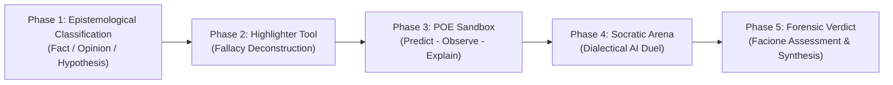

# ⚛️ Physics Detective: Fallacy Investigation & Empirical Truth
## Socratic Dialectical Arena & Critical Thinking Scaffolding in High School Physics

[](https://sinhvien-dhs.github.io/nckh/)
[](https://sinhvien-dhs.github.io/nckh/?mode=admin)
[-f59e0b?style=for-the-badge)](https://sinhvien-dhs.github.io/nckh/)
[](LICENSE)

> **Pedagogical Scientific Research Project (NCKH):**  
> *"Design and implementation of an AI-scaffolded gamified learning environment to foster students' critical thinking competencies in high school physics education"*  
> *(Aligned with the Vietnam National General Education Curriculum 2018 — Grade 10 Classical Mechanics & Dynamics).*

---

## 🌐 Live Demonstrations

- 🎮 **Student Investigation Game Interface:** [https://sinhvien-dhs.github.io/nckh/](https://sinhvien-dhs.github.io/nckh/)
- 🛡️ **Teacher Administration & Pedagogical Analytics Dashboard:** [https://sinhvien-dhs.github.io/nckh/?mode=admin](https://sinhvien-dhs.github.io/nckh/?mode=admin)  
  *(Secure Administrator Access PIN: `10112026`)*

---

## 🌟 Key Innovations & User Experience (UX/UI)

### 1. 📱 Native Mobile-First Engineering
- Architected for students accessing via **smartphones** through teacher-distributed QR codes and hyperlinks in classroom settings.
- Physics Simulation Canvas dynamically preserves a calibrated `700 : 380` aspect ratio via pure CSS without graphic distortion or horizontal overflow across narrow vertical screens.
- Responsive **Portrait Orientation Guidance** (`.mobile-orient-tip`) automatically prompts users on displays $< 480\text{ px}$ to rotate horizontally for optimal vector visualization.
- Compliant with mobile human interface guidelines (touch target minimum height $\ge 44\text{ px}$, input font size set to $16\text{ px}$ to eliminate unwanted iOS Safari auto-zooming).
- Integrated floating **Section-Switching Pill** (`#mobileJumpPill`) enabling seamless, single-tap transitions between the Investigation Dossier and the Interactive Sandbox without tedious scrolling.

### 2. ⚡ "Cut to the Chase" Interactive Onboarding (30-Second Socratic Challenge)
- Replaces static, text-heavy pedagogical rulebooks with an immediate active challenge:
  - Adversarial AI Dr. Sophos introduces an intuitive misconception: *"A 10kg mass falls 10 times faster than a 1kg mass because the Earth pulls it 10 times harder!"*
  - The student executes the **[💥 REFUTE NOW]** action: An immediate audio cue sounds, Dr. Sophos's vitality bar drops to $0$, and the learner receives **+50 Trial Points**.
  - Internalizes the core epistemological loop within 30 seconds: **Encounter Fallacy $\rightarrow$ Refute via Physical Principles $\rightarrow$ Earn Mastery Recognition**.

### 3. 🖍️ Tactile Highlighter Scaffolding (Fluorescent Epistemological Marker)
- Enables direct tactile and click-based highlighting of premise segments within Dr. Sophos's fallacious arguments in **Phase 2**.
- Physically engages higher-order reasoning:
  - **Accurate Identification:** Illuminates with an amber fluorescent glow, triggers a positive audio response, unlocks the formal fallacy taxonomy breakdown, and awards Facione $T_1 / T_2$ diagnostic credit.
  - **Neutral Premise Tap:** Delivers constructive pedagogical hints guiding the learner toward logical non-sequiturs and equivocation without penalizing score.

### 4. 🎚️ 5-Tier Cognitive Confidence Calibration (POE Metacognition)
- Quantifies metacognitive self-regulation through a discrete Likert slider (`step="20"`, range $20\% - 100\%$) perfectly balanced over thumb stops:
  - **20%**: Ambiguous Conjecturing *(Blind Guess)*
  - **40%**: Insufficient Evidential Grounds *(Hesitant Doubt)*
  - **60%**: Balanced Deliberation 50/50 *(Plausible Skepticism)*
  - **80%**: Substantiated Conviction *(High Confidence)*
  - **100%**: Categorical Certitude *(Absolute Certainty)*
- Pixel-perfect spatial alignment ensures percentage labels and target dots sit directly beneath the slider thumb across all viewports.

---

## 🔬 6 Dynamics Case Files (60 FPS HTML5 Canvas Engine)

Every simulation operates on an analytical physics engine running at 60 FPS, with real-time vector field overlays (Force $\vec{F}$, Velocity $\vec{v}$, Acceleration $\vec{a}$) and telemetry readouts:

| Case | Title & Paradigm | Curriculum Standard | Physical Core & Empirical Sandbox |
| :---: | :--- | :--- | :--- |
| **01** | **The Pisa Tower Mystery** | Free Fall & Air Resistance *(Lessons 10 & 11)* | Refutation of the Aristotelian mass-proportional falling fallacy; 6-environment celestial gravity selector: *Earth (Atmospheric / Vacuum with $F_{\text{drag}} = 0$), Mars ($3.72\text{ m/s}^2$), Moon ($1.62\text{ m/s}^2$), Pluto ($0.62\text{ m/s}^2$), Sun ($274.0\text{ m/s}^2 = 28g$)*. |
| **02** | **The Intersection Collision** | Newton's 3rd Law *(Lesson 16)* | Collision between a 5000kg container truck and a 1000kg sedan; proves rigorous action-reaction equivalence ($F_{12} = -F_{21}$) while attributing differential structural damage to material yield thresholds and inertial acceleration $a = F/m$. |
| **03** | **The Fatal Curve** | Centripetal Force & Inertia *(Lesson 32)* | Uniform circular motion with tether-cutting trigger; disproves the "centrifugal force" non-inertial illusion, demonstrating tangential velocity persistence governed by Newton's 1st Law. |
| **04** | **Inclined Plane Skidding** | Inclined Plane & Dynamic Friction *(Lesson 17)* | Orthogonal vector resolution of gravity into parallel $P_x = mg\sin\alpha$ and perpendicular $P_y = mg\cos\alpha$; mathematically explains why steeper inclines reduce normal contact force $N$ and kinetic friction $F_{\text{k}} = \mu N$. |
| **05** | **Armored Vehicle Catastrophe** | Momentum Conservation & Inelastic Collisions *(Lesson 19)* | Completely inelastic collision between two armored personnel carriers (APCs); demonstrates total momentum conservation $\vec{p} = \text{const}$ alongside mechanical energy dissipation into thermal entropy and plastic deformation work. |
| **06** | **High-Altitude Skydiver** | Fluid Drag & Terminal Velocity *(Lesson 11)* | Stratospheric free fall with deployable parachute; elucidates dynamic equilibrium where aerodynamic drag offsets weight ($F_{\text{drag}} = P \implies \Sigma F = 0 \implies a = 0$), resulting in uniform terminal velocity descent ($v_{\text{terminal}}$). |

---

## 🧭 Standardized 5-Phase Pedagogical Workflow



1. **Phase 1 — Evidence Classification:** Distinguishes empirical observations (*Facts*) from unverified assertions (*Opinions*) and testable theoretical propositions (*Hypotheses*).
2. **Phase 2 — Highlighter Fallacy Hunting:** Employs the fluorescent marker tool to isolate rhetorical and formal logical fallacies introduced by AI Dr. Sophos (*Hasty Generalization, Appeal to Authority, Strawman Fallacy, Non-Inertial Equivocation*).
3. **Phase 3 — POE Sandbox (Predict - Observe - Explain):** Prompts formulated hypothesis formulation, metacognitive confidence rating, and hands-on empirical observation via 60 FPS numerical simulation.
4. **Phase 4 — Socratic Dialectical Duel:** Marshals empirical measurements and dynamical formulas as ammunition to systematically dismantle Sophos's fallacious arguments over multiple dialectical rounds.
5. **Phase 5 — Scientific Verdict & Diagnostics:** Synthesizes cumulative investigation scores (up to **900 points**), awards merit rankings (*Novice $\rightarrow$ Logic Detective $\rightarrow$ Socratic Investigator $\rightarrow$ Master of Critical Reason*), and delivers personalized pedagogical feedback.

---

## 📊 Teacher Administration & Pedagogical Analytics Dashboard

Engineered specifically to support educational researchers, thesis authors, and classroom practitioners:

- **Facione (1990) & Ennis (2011) Critical Thinking Matrix:** Radar Chart visualization mapping 4 developmental facets:
  - $T_1$ — **Interpretation:** Competency in delineating, cataloging, and decoding empirical facts.
  - $T_2$ — **Analysis:** Ability to detect premise contradictions, hidden assumptions, and rhetorical traps.
  - $T_3$ — **Evaluation:** Capability to assess evidential validity and empirical verifiability.
  - $T_4$ — **Inference & Self-Regulation:** Skill in deducing logically coherent conclusions and calibrating cognitive confidence.
- **Embedded SPSS 26.0 Statistical Validation Grid:** Displays empirical trial results evaluated via Paired-Samples T-Test ($N = 45$):
  $$\text{Pre-test Score: } 5.12 \pm 1.05 \quad \longrightarrow \quad \text{Post-test Score: } 7.84 \pm 0.92$$
  $$t(44) = 12.45, \quad p < 0.001, \quad \text{Cohen's } d = 1.18 \text{ (Very Large Effect Size)}$$
- **Student Epistemological Ledger:** Time-stamped auditing of every classification, prediction choice, confidence score, and duel selection.
- **Data Export & Publication Ready Reporting:**
  - **Export JSON** feature structured for seamless ingestion into SPSS, R Studio, or Python Pandas.
  - **Clean Print CSS Engine** configured for automated, distraction-free A4 report printing.

---

## 🛠️ Technology Stack & Architecture (Zero External Dependencies)

The codebase strictly adheres to a **Pure Vanilla Web Architecture**, devoid of external libraries, bundlers, or third-party runtime frameworks to ensure instant cold-start velocity, high durability, and offline resilience:

```
├── index.html                  # Unified Application Shell (Student Arena & Admin Dashboard)
├── server.js                   # Lightweight Node.js Server with Safe UTF-8 URI Decoding
├── manifest.json               # Progressive Web App (PWA) Manifest Configuration
├── LICENSE                     # Project License & Research Credits
├── css/
│   └── style.css               # Editorial Light/Dark Design System & Mobile-First CSS
└── js/
    ├── app.js                  # Application Lifecycle, State Router & Onboarding Logic
    ├── audio-fx.js             # Synthesized Procedural Audio Engine (Web Audio API)
    ├── cases-data.js           # Database of 6 Mechanics Cases, Fallacy Taxonomies & Segments
    ├── physics-engine.js       # Discrete Euler/Verlet Numerical Integrators (60 FPS)
    ├── vector-renderer.js      # HTML5 Canvas Vector Overlay & Telemetry Renderer
    ├── investigation-engine.js # Core 5-Phase State Machine, Highlighter & Scoring Engine
    └── pedagogy-analytics.js   # Facione Radar Chart & SPSS Empirical Data Reporter
```

---

## 🚀 Installation & Deployment

### Method 1: Instant Cloud Access (Recommended)
Access immediately via GitHub Pages without installation: **[https://sinhvien-dhs.github.io/nckh/](https://sinhvien-dhs.github.io/nckh/)**

### Method 2: Local Node.js Development Server
```bash
# Clone the repository
git clone https://github.com/sinhvien-dhs/nckh.git
cd nckh

# Launch local server
node server.js
```
Open your browser at: **`http://localhost:3000`**

### Method 3: Standalone Offline Execution
Double-click `index.html` directly from your file manager. The entire system executes client-side with zero external internet dependencies.

---

## 👨‍🏫 Authors & Citation

- **Research Authors:** Students of the Faculty of Physics, University of Education, Hue University (Sinh viên Khoa Vật lý, Trường Đại học Sư phạm, Đại học Huế).
- **Academic Context:** Scientific Research Project on Innovative Digital Pedagogical Methodologies in High School Physics Education under the 2018 National General Education Curriculum (GEC 2018).

---

## 📄 License

This project is released under the [License](LICENSE) &copy; 2026 Students of the Faculty of Physics, University of Education, Hue University (Khoa Vật lý, Trường Đại học Sư phạm, Đại học Huế).
